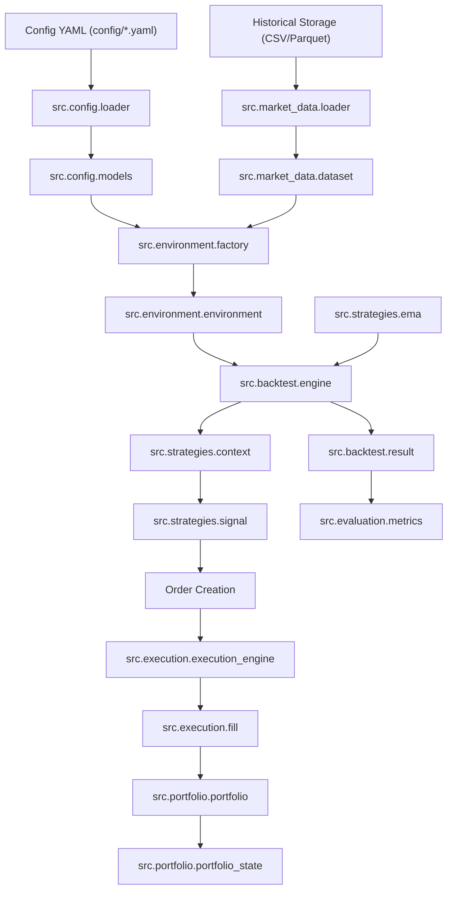

# Mã Nguồn Hệ Thống Quant Engine (`src/`) — Báo Cáo Kiến Trúc & Chi Tiết File, Hàm, Tác Dụng & Mối Liên Kết

Tài liệu này là **Catalog Mã Nguồn Toàn Diện** cho thư mục `src/`, liệt kê đầy đủ tất cả các gói (packages), các file nguồn (`.py`), các lớp (classes) và hàm (functions) bên trong từng file, cùng mục đích sử dụng, tham số đầu vào/đầu ra, tác động hệ thống, và ma trận liên kết giữa các module trong hệ thống quantitative trading.

---

## 📑 Bảng Mục Lục

1. [Tổng Quan Kiến Trúc & Sơ Đồ Luồng Dữ Liệu](#1-tổng-quan-kiến-trúc--sơ-đồ-luồng-dữ-liệu)
2. [Cây Thư Mục & Danh Mục File (`src/`)](#2-cây-thư-mục--danh-mục-file-src)
3. [Chi Tiết Từng Phân Hệ & File Mã Nguồn](#3-chi-tiết-từng-phân-hệ--file-mã-nguồn)
   - [3.1 Phase 0: Core Subsystem (`src/core/`)](#31-phase-0-core-subsystem-srccore)
   - [3.2 Phase 0: Configuration Subsystem (`src/config/`)](#32-phase-0-configuration-subsystem-srcconfig)
   - [3.3 Phase 0: Environment Subsystem (`src/environment/`)](#33-phase-0-environment-subsystem-srcenvironment)
   - [3.4 Phase 0/5: Experiment Planning Subsystem (`src/experiments/`)](#34-phase-05-experiment-planning-subsystem-srcexperiments)
   - [3.5 Phase 1: Market Data Subsystem (`src/market_data/`)](#35-phase-1-market-data-subsystem-srcmarket_data)
   - [3.6 Phase 1: Feature Engineering Subsystem (`src/features/`)](#36-phase-1-feature-engineering-subsystem-srcfeatures)
   - [3.7 Phase 4: Strategy Contract Subsystem (`src/strategies/`)](#37-phase-4-strategy-contract-subsystem-srcstrategies)
   - [3.8 Phase 2: Execution Subsystem (`src/execution/`)](#38-phase-2-execution-subsystem-srcexecution)
   - [3.9 Phase 3: Portfolio & Accounting Subsystem (`src/portfolio/`)](#39-phase-3-portfolio--accounting-subsystem-srcportfolio)
   - [3.10 Phase 4: Backtest Engine Subsystem (`src/backtest/`)](#310-phase-4-backtest-engine-subsystem-srcbacktest)
   - [3.11 Phase 5: Evaluation & Metrics Subsystem (`src/evaluation/`)](#311-phase-5-evaluation--metrics-subsystem-srcevaluation)
   - [3.12 Quant Lab Pipeline (`src/quant_lab/`)](#312-quant-lab-pipeline-srcquant_lab)
   - [3.13 Trend Engine Core (`src/trend_engine.py`)](#313-trend-engine-core-srctrend_enginepy)
4. [Ma Trận Phụ Thuộc Hướng (DAG & Dependency Direction)](#4-ma-trận-phụ-thuộc-hướng-dag--dependency-direction)
5. [Quy Trình Kiểm Thử & Kiểm Chứng Hệ Thống](#5-quy-trình-kiểm-thử--kiểm-chứng-hệ-thống)

---

## 1. Tổng Quan Kiến Trúc & Sơ Đồ Luồng Dữ Liệu

Hệ thống được thiết kế theo kiến trúc **10-Phase Quant Engine Mô-đun Hóa** dựa trên các nguyên tắc phát triển phần mềm tiên tiến:
- **SRP (Single Responsibility Principle)**: Mỗi file/hàm chỉ chịu một trách nhiệm duy nhất.
- **Causal Execution**: Không lộ dữ liệu tương lai (No temporal look-ahead bias).
- **Immutable State Snapshots**: Các đối tượng dữ liệu lõi (`Order`, `Fill`, `Position`, `Account`, `PortfolioState`, `Signal`, `BacktestResult`) là bất biến (`frozen=True`).
- **DAG Dependency Control**: Quản lý phụ thuộc 1 chiều nghiêm ngặt (ví dụ: `strategies` không bao giờ phụ thuộc vào `portfolio` hay `execution`).



---

## 2. Cây Thư Mục & Danh Mục File (`src/`)

```text
src/
├── core/                        # Phase 0: Nguyên mẫu hệ thống, kiểu dữ liệu lõi & Đồng hồ thời gian
│   ├── types.py                 # Kiểu primitive (Price, Quantity, Symbol) & UTC validation
│   ├── clock.py                 # Protocol Clock, HistoricalClock (simulation) & RealtimeClock
│   ├── ids.py                   # Immutable ID value objects (OrderId, FillId, StrategyId,...)
│   ├── events.py                # Class Event bất biến cho event-driven loop
│   └── exceptions.py            # Base system exception (QuantSystemError)
│
├── config/                      # Phase 0: Cấu hình hệ thống & Validation
│   ├── models.py                # Typed Dataclass bất biến cho cấu hình
│   ├── loader.py                # ConfigLoader đọc YAML từ đĩa
│   ├── validation.py            # Engine validate tính hợp lệ của cấu hình
│   └── exceptions.py            # Ngoại lệ cấu hình (ConfigError, ConfigParseError)
│
├── environment/                 # Phase 0: Môi trường thực thi & Dependency Injection
│   ├── registry.py              # Service Registry quản lý singletons cách ly
│   ├── environment.py           # Container Environment tổng hợp tài nguyên
│   ├── context.py               # Container ExecutionContext cho lượt chạy
│   ├── factory.py               # Factory khởi tạo Environment cách ly 100%
│   └── exceptions.py            # Ngoại lệ môi trường (EnvironmentError)
│
├── experiments/                 # Phase 0/5: Lập kế hoạch thử nghiệm & Quản lý cửa sổ thời gian
│   ├── config.py                # Typed TimeConfig parser & validator
│   ├── window.py                # Dataclass bất biến TimeWindow (warmup & execution bounds)
│   ├── run.py                   # Dataclass bất biến ExperimentRun (run_id, seed, window)
│   └── planner.py               # Engine TimePlanner tính toán cửa sổ thời gian
│
├── market_data/                 # Phase 1: Đọc, kiểm định & Quản lý danh mục Dataset
│   ├── market.py                # Dataclass bất biến Market (venue, symbol, quote_currency)
│   ├── timeframe.py             # Enum Timeframe (M1, M15, H1, D1) & quy đổi giây
│   ├── dataset.py               # Dataclass bất biến Dataset & DataRange
│   ├── versioning.py            # Engine tính SHA-256 content hash kiểm soát phiên bản
│   ├── catalog.py               # Quản lý danh mục registry DatasetCatalog
│   ├── loader.py                # DatasetLoader kiểm định OHLCV, timestamp UTC & thiếu nến
│   ├── compatibility.py         # Kiểm tra tính tương thích giữa Strategy và Execution datasets
│   └── exceptions.py            # Ngoại lệ dữ liệu thị trường (DataValidationError)
│
├── features/                    # Phase 1: Tính toán tính chất kỹ thuật (Features)
│   └── __init__.py              # Feature engine interface
│
├── strategies/                  # Phase 4: Hợp đồng Chiến lược (Strategy DSL Contract)
│   ├── signal.py                # Enum SignalAction & Dataclass bất biến Signal
│   ├── context.py               # Dataclass read-only StrategyContext truyền cho chiến lược
│   ├── strategy.py              # Interface/Protocol Strategy với hàm on_bar(context)
│   ├── ema.py                   # Reference Strategy EMA (EMA20 > EMA50 -> LONG)
│   └── exceptions.py            # Ngoại lệ chiến lược (StrategyError, InvalidSignalError)
│
├── execution/                   # Phase 2: Mô phỏng khớp lệnh, Phí, Trượt giá & Funding Rate
│   ├── order.py                 # Enums OrderSide, OrderType, OrderStatus & Dataclass Order
│   ├── fill.py                  # Dataclass bất biến Fill đại diện khớp lệnh thành công
│   ├── result.py                # Dataclass ExecutionResult tổng hợp audit trail khớp lệnh
│   ├── fill_model.py            # Abstract FillModel, OHLCFillModel & LowerTimeframeReplayFillModel
│   ├── slippage.py              # FixedSlippageModel & VolatilitySlippageModel (ATR)
│   ├── fee.py                   # PercentageFeeModel (Maker/Taker commission)
│   ├── funding.py               # PerpetualFundingModel (Phí 8h Perpetual Crypto)
│   ├── broker.py                # Interface Broker & HistoricalBroker
│   ├── execution_engine.py      # Orchestrator quản lý lifecycle của Order và bắn Fill
│   └── exceptions.py            # Ngoại lệ thực thi (ExecutionError, InvalidOrderError)
│
├── portfolio/                   # Phase 3: Quản lý vị thế, Tài khoản & Kế toán PnL
│   ├── account.py               # Account bất biến theo dõi Balance, Realized PnL, Fees Paid
│   ├── position.py              # Position bất biến (enforces quantity > 0) & PositionSide
│   ├── pnl.py                   # Công thức thuần tính Realized PnL & Mark-to-Market Unrealized PnL
│   ├── margin.py                # MarginModel & SimpleMarginModel tính toán ký quỹ & đòn bẩy
│   ├── risk_manager.py          # RiskManager kiểm định hạn mức rủi ro trước khi vào lệnh
│   ├── portfolio_state.py       # Snapshot bất biến PortfolioState
│   ├── portfolio.py             # Class orchestrator Portfolio quản lý 5 vòng đời vị thế
│   └── exceptions.py            # Ngoại lệ portfolio (PortfolioException, InsufficientMarginError)
│
├── backtest/                    # Phase 4: Engine Mô phỏng Backtest Lịch sử
│   ├── state.py                 # Container BacktestState theo dõi tiến trình nến
│   ├── result.py                # Snapshot bất biến BacktestResult chứa toàn bộ lịch sử chạy
│   ├── engine.py                # Orchestrator BacktestEngine điều phối nến T+1 causal loop
│   └── exceptions.py            # Ngoại lệ backtest (BacktestError, BacktestExecutionError)
│
├── evaluation/                  # Phase 5: Đánh giá Hiệu năng & Chỉ số Định lượng
│   ├── metrics.py               # Dataclass BasicMetrics & calculate_basic_metrics() read-only
│   └── exceptions.py            # Ngoại lệ đánh giá (EvaluationError, InvalidEvaluationError)
│
├── quant_lab/                   # Lab Pipeline v1.0 (Script Runner Support)
│   ├── data_feed.py             # Tải dữ liệu M15, Wilder RMA ATR 14 & Causal Swing Engine
│   ├── zone_engine.py           # Bộ lọc Fibo Zone Registry & ATR Dynamic Buffer
│   ├── projection_engine.py     # Dự phóng hình học Target Zone theo Causal Swing
│   ├── state_machine.py         # State Machine 5 giai đoạn (Stage 0 -> Stage 4 Entry)
│   ├── atr_ratchet.py           # ATR Trailing Ratchet Exit (Khóa cứng Stop Loss 14/3.0)
│   ├── execution_simulator.py   # Dual fill simulator (Wick Touch vs Bar Close)
│   ├── wfo_splitter.py          # Splitter Purged & Embargoed Walk-Forward Optimization
│   ├── optimizer.py             # Optuna Bayesian Optimizer & Plateau Champion Check
│   ├── alpha_decay.py           # Phân tích suy giảm Alpha 2 trục (Thời gian & Số lệnh)
│   └── reporting.py             # Xuất báo cáo tổng hợp OOS & Kết luận PASS/WARN/FAIL
│
└── trend_engine.py              # Core toán học thuật toán nấc thang VIP Trend Indicator
```

---

## 3. Chi Tiết Từng Phân Hệ & File Mã Nguồn

### 3.1 Phase 0: Core Subsystem (`src/core/`)

Phân hệ chứa các kiểu dữ liệu nền tảng, đồng hồ mô phỏng và định danh hệ thống.

#### 📄 [src/core/types.py](file:///d:/reverse_indi/src/core/types.py)
- **[MỤC ĐÍCH]**: Định nghĩa kiểu primitive lõi (`Symbol`, `Price`, `Quantity`) và hàm kiểm định thời gian UTC.
- **[CÁC HÀM CHÍNH]**:
  - `validate_utc_timestamp(dt: datetime) -> datetime`: Kiểm tra đối tượng datetime có timezone-aware và đúng múi giờ UTC hay không. Ném `QuantSystemError` nếu là datetime naive.
  - `create_utc_timestamp(val: Union[str, datetime]) -> datetime`: Quy đổi chuỗi ISO 8601 (ví dụ `'2026-09-18T15:30:00Z'`) hoặc datetime thành chuẩn UTC-aware.
- **[MỐI LIÊN KẾT & TÁC ĐỘNG]**: Độc lập tuyệt đối. Được tất cả 13 subpackage còn lại import để đảm bảo tính đồng bộ thời gian UTC.

#### 📄 [src/core/clock.py](file:///d:/reverse_indi/src/core/clock.py)
- **[MỤC ĐÍCH]**: Cung cấp hợp đồng thời gian `Clock` và triển khai đồng hồ lịch sử `HistoricalClock` cho backtest.
- **[CÁC LỚP & HÀM CHÍNH]**:
  - `Clock(Protocol)`: Interface trừu tượng khai báo phương thức `now() -> datetime`.
  - `HistoricalClock(start_time: datetime)`: Đồng hồ mô phỏng cho backtest.
    - `now() -> datetime`: Trả về thời gian hiện tại của mô phỏng.
    - `set(dt: datetime)`: Đặt thời gian mô phỏng.
    - `advance_to(dt: datetime)`: Tiến thời gian về phía trước. Ném `QuantSystemError` nếu cố tình đi lùi thời gian (`dt < current_time`).
  - `RealtimeClock`: Trả về `datetime.now(timezone.utc)` phục vụ paper/live trading.
- **[MỐI LIÊN KẾT & TÁC ĐỘNG]**: Được `Environment`, `ExecutionEngine`, và `BacktestEngine` sử dụng để điều phối dòng thời gian mô phỏng.

#### 📄 [src/core/ids.py](file:///d:/reverse_indi/src/core/ids.py)
- **[MỤC ĐÍCH]**: Cung cấp các Value Objects bọc định danh bất biến (Strongly-typed IDs) nhằm loại bỏ lỗi gán nhầm chuỗi giữa các entity khác loại.
- **[CÁC LỚP & HÀM CHÍNH]**:
  - `BaseId(value: str)`: Class cơ sở bất biến (`frozen=True`). Enforces chuỗi không rỗng. Hàm `generate(prefix)` tạo ngẫu nhiên chuỗi hex UUID v4.
  - Các lớp con: `ExperimentId`, `RunId`, `StrategyId`, `OrderId`, `FillId`, `DatasetId`, `EventId`.
- **[MỐI LIÊN KẾT & TÁC ĐỘNG]**: Định danh cho `Order`, `Fill`, `Dataset`, `ExperimentRun`, `Strategy`.

#### 📄 [src/core/events.py](file:///d:/reverse_indi/src/core/events.py)
- **[MỤC ĐÍCH]**: Định nghĩa class sự kiện cơ sở `Event` làm nền tảng cho Event-Driven Architecture.
- **[CÁC LỚP & HÀM CHÍNH]**:
  - `Event(event_id: EventId, timestamp: datetime, sequence: int)`: Dataclass bất biến chứa ID sự kiện, nhãn thời gian UTC và số thứ tự `sequence` để sắp xếp sự kiện định tính.
- **[MỐI LIÊN KẾT & TÁC ĐỘNG]**: Làm tiền đề cho luồng sự kiện `MarketDataEvent`, `SignalEvent`, `OrderEvent`, `FillEvent`.

#### 📄 [src/core/exceptions.py](file:///d:/reverse_indi/src/core/exceptions.py)
- **[MỤC ĐÍCH]**: Định nghĩa ngoại lệ gốc `QuantSystemError` mà tất cả các ngoại lệ tùy chỉnh trong hệ thống đều phải kế thừa.
- **[MỐI LIÊN KẾT & TÁC ĐỘNG]**: Giúp bắt mọi lỗi chuyên biệt của hệ thống ở cấp cao nhất.

---

### 3.2 Phase 0: Configuration Subsystem (`src/config/`)

Phân hệ đọc, ép kiểu và kiểm định tính hợp lệ của tất cả các file cấu hình YAML.

#### 📄 [src/config/models.py](file:///d:/reverse_indi/src/config/models.py)
- **[MỤC ĐÍCH]**: Khai báo các Dataclass bất biến chứa tham số cấu hình đã được ép kiểu rõ ràng.
- **[CÁC LỚP CHÍNH]**:
  - `DefaultEnvConfig`: Cấu hình môi trường mặc định (initial_capital, venue, symbol, quote_currency, fee_rate, slippage_bps).
  - `DatasetRefConfig`: Tham chiếu cấu hình Dataset (dataset_id, symbol, timeframe, storage_path, content_hash).
  - `ExecutionConfig`: Cấu hình mô hình thực thi (fill_model, slippage_model, commission_rate).
  - `PortfolioConfig`: Cấu hình tài khoản & quản trị rủi ro (initial_capital, leverage, risk_per_trade_pct).
  - `ExperimentTimeConfig`: Cấu hình thời gian chạy thử nghiệm (mode, range, warmup).
  - `ExperimentConfig`: Dataclass tổng hợp chứa toàn bộ cấu hình của một thử nghiệm.
- **[MỐI LIÊN KẾT & TÁC ĐỘNG]**: Được `ConfigLoader` khởi tạo và truyền cho `EnvironmentFactory`.

#### 📄 [src/config/loader.py](file:///d:/reverse_indi/src/config/loader.py)
- **[MỤC ĐÍCH]**: Quản lý việc đọc file YAML từ đĩa và parse thành các đối tượng `ExperimentConfig` hoàn chỉnh.
- **[CÁC HÀM CHÍNH]**:
  - `load_default_env()`: Đọc `config/default.yaml`.
  - `load_dataset(name)`: Đọc file cấu hình dataset trong `config/datasets/`.
  - `load_execution(name)`: Đọc `config/execution.yaml`.
  - `load_portfolio(name)`: Đọc `config/portfolio.yaml`.
  - `load_experiment(name)`: Đọc và tổng hợp cấu hình thử nghiệm hoàn chỉnh từ `config/experiments/`.
- **[MỐI LIÊN KẾT & TÁC ĐỘNG]**: Phụ thuộc vào `pyyaml` và `src.config.models`.

#### 📄 [src/config/validation.py](file:///d:/reverse_indi/src/config/validation.py)
- **[MỤC ĐÍCH]**: Kiểm định hợp lệ toán học của đối tượng cấu hình (ví dụ: `initial_capital > 0`, `commission_rate >= 0`, `leverage >= 1`).
- **[CÁC HÀM CHÍNH]**:
  - `validate_experiment_config(config: ExperimentConfig) -> None`: Ném `ConfigValidationError` nếu phát hiện tham số không hợp lệ.

#### 📄 [src/config/exceptions.py](file:///d:/reverse_indi/src/config/exceptions.py)
- **[MỤC ĐÍCH]**: Định nghĩa cây ngoại lệ cho cấu hình: `ConfigError`, `ConfigFileNotFoundError`, `ConfigParseError`, `ConfigValidationError`.

---

### 3.3 Phase 0: Environment Subsystem (`src/environment/`)

Phân hệ đóng gói và quản lý sự phụ thuộc (Dependency Injection) giữa các tài nguyên chạy.

#### 📄 [src/environment/registry.py](file:///d:/reverse_indi/src/environment/registry.py)
- **[MỤC ĐÍCH]**: Container đăng ký service/module độc lập theo dạng key-value cách ly hoàn toàn, loại bỏ singleton toàn cục.
- **[CÁC HÀM CHÍNH]**:
  - `register(key, service)`: Đăng ký một service.
  - `get(key)`: Lấy service đã đăng ký.
  - `require(key)`: Lấy service bắt buộc (ném `MissingDependencyError` nếu không tồn tại).

#### 📄 [src/environment/environment.py](file:///d:/reverse_indi/src/environment/environment.py)
- **[MỤC ĐÍCH]**: Dataclass bất biến `Environment` chứa trọn vẹn tài nguyên của thế giới mô phỏng: `clock`, `market_data`, `execution`, `portfolio`, `config`, `registry`.

#### 📄 [src/environment/context.py](file:///d:/reverse_indi/src/environment/context.py)
- **[MỤC ĐÍCH]**: Dataclass bất biến `ExecutionContext` chứa thông tin ngữ cảnh lượt chạy (`clock`, `run`, `dataset_id`, `execution_id`).

#### 📄 [src/environment/factory.py](file:///d:/reverse_indi/src/environment/factory.py)
- **[MỤC ĐÍCH]**: Khởi tạo đối tượng `Environment` cách ly 100%, kết nối các phân hệ Core, MarketData, Execution và Portfolio theo đúng cấu hình.

---

### 3.4 Phase 0/5: Experiment Planning Subsystem (`src/experiments/`)

Phân hệ lập kế hoạch thử nghiệm và phân chia cửa sổ thời gian.

#### 📄 [src/experiments/config.py](file:///d:/reverse_indi/src/experiments/config.py)
- **[MỤC ĐÍCH]**: Parse và validate cấu hình thời gian `TimeConfig` (fixed, rolling, expanding), quy đổi chuỗi `Duration` (`'1y'`, `'6mo'`, `'30d'`).

#### 📄 [src/experiments/window.py](file:///d:/reverse_indi/src/experiments/window.py)
- **[MỤC ĐÍCH]**: Dataclass bất biến `TimeWindow` bảo đảm bất đẳng thức thời gian: `warmup_start <= execution_start < execution_end`.

#### 📄 [src/experiments/run.py](file:///d:/reverse_indi/src/experiments/run.py)
- **[MỤC ĐÍCH]**: Dataclass bất biến `ExperimentRun` đại diện cho 1 lượt chạy cụ thể (run_id, seed, window).

#### 📄 [src/experiments/planner.py](file:///d:/reverse_indi/src/experiments/planner.py)
- **[MỤC ĐÍCH]**: Engine `TimePlanner` giải quyết mốc thời gian `now`, tính toán cửa sổ warmup và sinh ra danh sách `ExperimentRun[]`.

---

### 3.5 Phase 1: Market Data Subsystem (`src/market_data/`)

Phân hệ đọc, làm sạch, quản lý danh mục và xác minh SHA-256 dữ liệu lịch sử.

#### 📄 [src/market_data/market.py](file:///d:/reverse_indi/src/market_data/market.py)
- **[MỤC ĐÍCH]**: Dataclass bất biến `Market` đại diện cho thị trường giao dịch (`venue`, `symbol`, `market_type`, `quote_currency`).

#### 📄 [src/market_data/timeframe.py](file:///d:/reverse_indi/src/market_data/timeframe.py)
- **[MỤC ĐÍCH]**: Enum `Timeframe` (M1, M5, M15, M30, H1, H4, D1) hỗ trợ quy đổi chính xác ra giây/phút và parse chuỗi `"15m"`.

#### 📄 [src/market_data/dataset.py](file:///d:/reverse_indi/src/market_data/dataset.py)
- **[MỤC ĐÍCH]**: Dataclass bất biến `Dataset` bọc thông tin định danh dataset, dải thời gian `DataRange` và đường dẫn lưu trữ.

#### 📄 [src/market_data/versioning.py](file:///d:/reverse_indi/src/market_data/versioning.py)
- **[MỤC ĐÍCH]**: Tính toán và xác minh mã hash SHA-256 nội dung của DataFrame để đảm bảo tính toàn vẹn dữ liệu.

#### 📄 [src/market_data/catalog.py](file:///d:/reverse_indi/src/market_data/catalog.py)
- **[MỤC ĐÍCH]**: Registry `DatasetCatalog` lưu trữ và tìm kiếm các đối tượng `Dataset` theo định danh.

#### 📄 [src/market_data/loader.py](file:///d:/reverse_indi/src/market_data/loader.py)
- **[MỤC ĐÍCH]**: `DatasetLoader` đọc file CSV/Parquet, kiểm tra bắt buộc nhãn UTC, duy trì tính tăng nghiêm ngặt của timestamp, kiểm tra bất đẳng thức OHLC (`high >= max(open, close)` và `low <= min(open, close)`), và phát hiện nến bị thiếu mà không forward-fill bừa bãi.

#### 📄 [src/market_data/compatibility.py](file:///d:/reverse_indi/src/market_data/compatibility.py)
- **[MỤC ĐÍCH]**: Hàm `validate_compatible_datasets()` kiểm tra sự tương thích giữa dataset dùng cho Strategy và dataset dùng cho Execution.

---

### 3.6 Phase 1: Feature Engineering Subsystem (`src/features/`)

- [src/features/__init__.py](file:///d:/reverse_indi/src/features/__init__.py): Interface tính toán các thuộc tính kỹ thuật (Causal Features) bảo đảm shift lag không lộ dữ liệu tương lai.

---

### 3.7 Phase 4: Strategy Contract Subsystem (`src/strategies/`)

Phân hệ giao diện hợp đồng chiến lược giao dịch (DSL Contract).

#### 📄 [src/strategies/signal.py](file:///d:/reverse_indi/src/strategies/signal.py)
- **[MỤC ĐÍCH]**: Enum `SignalAction` (`HOLD`, `LONG`, `SHORT`) và Dataclass bất biến `Signal` chứa tín hiệu phát ra từ chiến lược.

#### 📄 [src/strategies/context.py](file:///d:/reverse_indi/src/strategies/context.py)
- **[MỤC ĐÍCH]**: Dataclass bất biến `StrategyContext` đóng gói dữ liệu tại nến T (timestamp, price, position_side, features) truyền cho chiến lược quan sát.

#### 📄 [src/strategies/strategy.py](file:///d:/reverse_indi/src/strategies/strategy.py)
- **[MỤC ĐÍCH]**: Protocol `@runtime_checkable` định nghĩa hợp đồng chiến lược: bắt buộc phải có phương thức `on_bar(context: StrategyContext) -> Signal`.

#### 📄 [src/strategies/ema.py](file:///d:/reverse_indi/src/strategies/ema.py)
- **[MỤC ĐÍCH]**: Chiến lược tham chiếu `EMAStrategy` (EMA20 > EMA50 -> LONG, EMA20 < EMA50 -> SHORT, bằng nhau -> HOLD).

---

### 3.8 Phase 2: Execution Subsystem (`src/execution/`)

Phân hệ mô phỏng khớp lệnh, trượt giá, phí giao dịch commission và 8h Perpetual Funding Rate.

#### 📄 [src/execution/order.py](file:///d:/reverse_indi/src/execution/order.py)
- **[MỤC ĐÍCH]**: Enums `OrderSide` (BUY/SELL), `OrderType` (MARKET/LIMIT), `OrderStatus` (CREATED, SUBMITTED, ACCEPTED, FILLED, CANCELLED, REJECTED) và Dataclass bất biến `Order`.

#### 📄 [src/execution/fill.py](file:///d:/reverse_indi/src/execution/fill.py)
- **[MỤC ĐÍCH]**: Dataclass bất biến `Fill` đại diện cho một giao dịch đã được khớp lệnh thành công (chứa `fill_id`, `order_id`, `quantity > 0`, `price > 0`, `fee`, `timestamp`).

#### 📄 [src/execution/result.py](file:///d:/reverse_indi/src/execution/result.py)
- **[MỤC ĐÍCH]**: Dataclass `ExecutionResult` tổng hợp danh sách các khớp lệnh `Fill` từ một xử lý thị trường.

#### 📄 [src/execution/fill_model.py](file:///d:/reverse_indi/src/execution/fill_model.py)
- **[MỤC ĐÍCH]**: Lớp trừu tượng `FillModel`, `OHLCFillModel` (khớp lệnh Market ở giá Open nến $T+1$) và `LowerTimeframeReplayFillModel` (duyệt nến intrabar M1 xác định chính xác thứ tự chạm Stop Loss / Take Profit).

#### 📄 [src/execution/slippage.py](file:///d:/reverse_indi/src/execution/slippage.py)
- **[MỤC ĐÍCH]**: Mô hình trượt giá `FixedSlippageModel` (tính theo bps/ticks) và `VolatilitySlippageModel` (tính theo biến động ATR).

#### 📄 [src/execution/fee.py](file:///d:/reverse_indi/src/execution/fee.py)
- **[MỤC ĐÍCH]**: Mô hình phí commission `PercentageFeeModel` (tính % giá trị giao dịch cho Maker/Taker).

#### 📄 [src/execution/funding.py](file:///d:/reverse_indi/src/execution/funding.py)
- **[MỤC ĐÍCH]**: Mô hình phí Funding Rate 8h `PerpetualFundingModel` dành cho hợp đồng tương lai vĩnh cửu Crypto.

#### 📄 [src/execution/broker.py](file:///d:/reverse_indi/src/execution/broker.py)
- **[MỤC ĐÍCH]**: Gateway interface `Broker` và lớp triển khai `HistoricalBroker`.

#### 📄 [src/execution/execution_engine.py](file:///d:/reverse_indi/src/execution/execution_engine.py)
- **[MỤC ĐÍCH]**: Class điều phối `ExecutionEngine` nhận `Order`, quản lý danh sách lệnh chờ và khớp lệnh thành `Fill` khi dữ liệu nến mới tới.

---

### 3.9 Phase 3: Portfolio & Accounting Subsystem (`src/portfolio/`)

Phân hệ quản lý số dư tài khoản, vị thế, đòn bẩy ký quỹ và tính toán PnL.

#### 📄 [src/portfolio/account.py](file:///d:/reverse_indi/src/portfolio/account.py)
- **[MỤC ĐÍCH]**: Dataclass bất biến `Account` theo dõi `initial_capital`, `balance`, `realized_pnl`, `fees_paid`, `funding_paid`.

#### 📄 [src/portfolio/position.py](file:///d:/reverse_indi/src/portfolio/position.py)
- **[MỤC ĐÍCH]**: Enum `PositionSide` (`LONG`, `SHORT`) và Dataclass bất biến `Position` (cưỡng chế `quantity > 0` tuyệt đối, lưu `entry_price` bình quân gia quyền).

#### 📄 [src/portfolio/pnl.py](file:///d:/reverse_indi/src/portfolio/pnl.py)
- **[MỤC ĐÍCH]**: Các hàm thuần toán học tính Realized PnL (`calculate_realized_pnl`) và Mark-to-Market Unrealized PnL (`calculate_unrealized_pnl`).

#### 📄 [src/portfolio/margin.py](file:///d:/reverse_indi/src/portfolio/margin.py)
- **[MỤC ĐÍCH]**: Mô hình ký quỹ `SimpleMarginModel` tính toán `position_notional`, `used_margin` và `available_margin`.

#### 📄 [src/portfolio/risk_manager.py](file:///d:/reverse_indi/src/portfolio/risk_manager.py)
- **[MỤC ĐÍCH]**: Guardrail `RiskManager` kiểm định pre-execution (cho phép short, max size, max leverage, risk-sizing theo % equity và khoảng dừng lỗ Stop Loss).

#### 📄 [src/portfolio/portfolio_state.py](file:///d:/reverse_indi/src/portfolio/portfolio_state.py)
- **[MỤC ĐÍCH]**: Snapshot bất biến `PortfolioState` lưu lại toàn bộ trạng thái tài khoản tại một mốc thời gian.

#### 📄 [src/portfolio/portfolio.py](file:///d:/reverse_indi/src/portfolio/portfolio.py)
- **[MỤC ĐÍCH]**: Class orchestrator `Portfolio` xử lý 5 vòng đời vị thế khi nhận `Fill` (Open, Increase, Reduce, Close, và Reversal 2 bước) và cập nhật Mark-to-Market.

---

### 3.10 Phase 4: Backtest Engine Subsystem (`src/backtest/`)

Phân hệ điều phối vòng lặp mô phỏng backtest lịch sử.

#### 📄 [src/backtest/state.py](file:///d:/reverse_indi/src/backtest/state.py)
- **[MỤC ĐÍCH]**: Dataclass `BacktestState` đóng vai trò bộ nhớ theo dõi tiến trình duyệt nến (signals, orders, fills, portfolio_states).

#### 📄 [src/backtest/result.py](file:///d:/reverse_indi/src/backtest/result.py)
- **[MỤC ĐÍCH]**: Dataclass bất biến `BacktestResult` đóng gói toàn bộ kết quả của 1 lượt backtest hoàn chỉnh.

#### 📄 [src/backtest/engine.py](file:///d:/reverse_indi/src/backtest/engine.py)
- **[MỤC ĐÍCH]**: Class điều phối `BacktestEngine` chạy vòng lặp nến causal:
  1. Tiến đồng hồ `HistoricalClock`.
  2. Khớp các lệnh chờ từ các nến trước ($T-1$) ở đầu nến $T$ (giá Open $T$).
  3. Cập nhật Mark-to-Market giá Close $T$.
  4. Cho `Strategy` quan sát nến $T$ và phát tín hiệu `Signal`.
  5. Chuyển tín hiệu thành lệnh `Order` mới (lệnh sẽ được khớp từ đầu nến $T+1$).

---

### 3.11 Phase 5: Evaluation & Metrics Subsystem (`src/evaluation/`)

Phân hệ đánh giá chỉ số hiệu năng giao dịch.

#### 📄 [src/evaluation/metrics.py](file:///d:/reverse_indi/src/evaluation/metrics.py)
- **[MỤC ĐÍCH]**: Dataclass bất biến `BasicMetrics` và hàm thuần `calculate_basic_metrics(result: BacktestResult)` tính toán các chỉ số cơ bản (net_pnl, return_pct, total_fees, trade_count, win_rate, equity_curve) ở chế độ read-only 100%.

---

### 3.12 Quant Lab Pipeline (`src/quant_lab/`)

Phân hệ phục vụ runner CLI `run_pipeline.py` cho chiến lược VIP Multi-Trend Indicator:
- [data_feed.py](file:///d:/reverse_indi/src/quant_lab/data_feed.py): Tải dữ liệu M15, Wilder RMA ATR 14 & Causal Swing Engine.
- [zone_engine.py](file:///d:/reverse_indi/src/quant_lab/zone_engine.py): Bộ lọc Fibo Zone Registry & ATR Dynamic Buffer.
- [projection_engine.py](file:///d:/reverse_indi/src/quant_lab/projection_engine.py): Dự phóng Target Zone theo Causal Swing.
- [state_machine.py](file:///d:/reverse_indi/src/quant_lab/state_machine.py): Quản lý State Machine 5 giai đoạn.
- [atr_ratchet.py](file:///d:/reverse_indi/src/quant_lab/atr_ratchet.py): Trailing ATR Ratchet Exit 14/3.0.
- [execution_simulator.py](file:///d:/reverse_indi/src/quant_lab/execution_simulator.py): Dual fill simulator (Wick Touch vs Bar Close).
- [wfo_splitter.py](file:///d:/reverse_indi/src/quant_lab/wfo_splitter.py): Walk-Forward Optimization Splitter.
- [optimizer.py](file:///d:/reverse_indi/src/quant_lab/optimizer.py): Optuna Bayesian Optimizer & Plateau Champion Check.
- [alpha_decay.py](file:///d:/reverse_indi/src/quant_lab/alpha_decay.py): Phân tích suy giảm Alpha 2 trục.
- [reporting.py](file:///d:/reverse_indi/src/quant_lab/reporting.py): Xuất báo cáo tổng hợp OOS & Kết luận PASS/WARN/FAIL.

---

### 3.13 Trend Engine Core (`src/trend_engine.py`)

- [src/trend_engine.py](file:///d:/reverse_indi/src/trend_engine.py): Triển khai thuật toán nấc thang 3 đường VIP Trend Indicator (`tc1`, `tc2`, `tc3`) khớp 99.98% với mã Pine Script v5.

---

## 4. Ma Trận Phụ Thuộc Hướng (DAG & Dependency Direction)

Hệ thống bắt buộc tuân thủ ma trận phụ thuộc hướng 1 chiều sau:

| Module Nguồn (`source`) | Được phép phụ thuộc vào (`allowed dependencies`) |
| :--- | :--- |
| `src.core` | `src.core` |
| `src.config` | `src.core`, `src.config` |
| `src.market_data` | `src.core`, `src.config`, `src.market_data` |
| `src.features` | `src.core`, `src.market_data`, `src.features` |
| `src.strategies` | `src.core`, `src.features`, `src.strategies` |
| `src.execution` | `src.core`, `src.config`, `src.market_data`, `src.execution` |
| `src.portfolio` | `src.core`, `src.config`, `src.execution`, `src.portfolio` |
| `src.environment` | `src.core`, `src.config`, `src.market_data`, `src.execution`, `src.portfolio`, `src.environment` |
| `src.experiments` | `src.core`, `src.experiments` |
| `src.backtest` | `src.core`, `src.config`, `src.market_data`, `src.execution`, `src.portfolio`, `src.environment`, `src.strategies`, `src.experiments`, `src.backtest` |
| `src.evaluation` | `src.core`, `src.backtest`, `src.evaluation` |

---

## 5. Quy Trình Kiểm Thử & Kiểm Chứng Hệ Thống

Để đảm bảo tính đúng đắn của toàn bộ các file trong `src/`, hệ thống đi kèm bộ kiểm thử đa tầng **115 test cases** trong `tests/`:

```bash
# Chạy toàn bộ 115 unit & architecture tests
.\venv\Scripts\python.exe -m unittest discover -s tests
```

Bộ test bao gồm **Mutation Campaign v2** (48 fault injections có chủ đích) đạt **Mutation Detection Rate 100.0%**, sẵn sàng bảo vệ hệ thống trước mọi nguy cơ phá vỡ ranh giới kiến trúc hay sai lệch kế toán.
