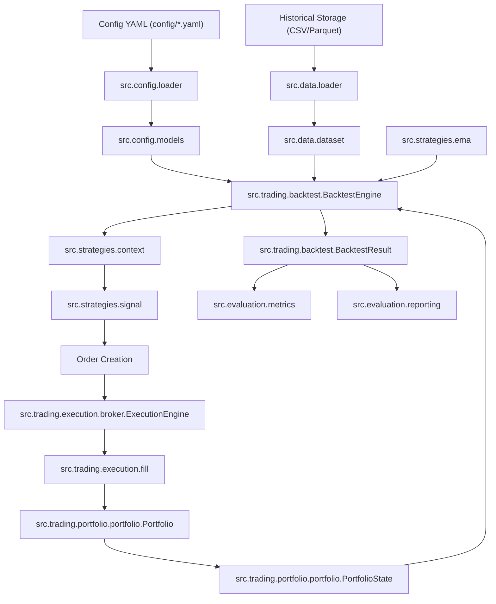

# Catalog Mã Nguồn Hệ Thống Quant Engine (`src/`) — Final Architecture

Tài liệu này là **Catalog Mã Nguồn Toàn Diện** cho thư mục `src/`, liệt kê đầy đủ tất cả các phân hệ (domain packages), các gói con (sub-packages), các file nguồn (`.py`), các lớp (classes) và hàm (functions) bên trong từng file, cùng mục đích sử dụng, tham số đầu vào/đầu ra, tác động hệ thống, liên kết mã nguồn và ma trận liên kết giữa các module theo đúng **Kiến Trúc Cuối Cùng (FINAL ARCHITECTURE)**.

---

## 📑 Bảng Mục Lục

1. [Tổng Quan Kiến Trúc & Sơ Đồ Luồng Dữ Liệu](#1-tổng-quan-kiến-trúc--sơ-đồ-luồng-dữ-liệu)
2. [Cây Thư Mục Hoàn Chỉnh (`src/`)](#2-cây-thư-mục-hoàn-chỉnh-src)
3. [Chi Tiết Từng Phân Hệ & File Mã Nguồn](#3-chi-tiết-từng-phân-hệ--file-mã-nguồn)
   - [3.1 Configuration Subsystem (`src/config/`)](#31-configuration-subsystem-srcconfig)
   - [3.2 Data Subsystem (`src/data/`)](#32-data-subsystem-srcdata)
   - [3.3 Feature Engineering Subsystem (`src/features/`)](#33-feature-engineering-subsystem-srcfeatures)
   - [3.4 Strategy Contract Subsystem (`src/strategies/`)](#34-strategy-contract-subsystem-srcstrategies)
   - [3.5 Trading Subsystem (`src/trading/`)](#35-trading-subsystem-srctrading)
     - [3.5.1 Execution Subpackage (`src/trading/execution/`)](#351-execution-subpackage-srctradingexecution)
     - [3.5.2 Portfolio Subpackage (`src/trading/portfolio/`)](#352-portfolio-subpackage-srctradingportfolio)
     - [3.5.3 Backtest Coordinator (`src/trading/backtest.py`)](#353-backtest-coordinator-srctradingbacktestpy)
   - [3.6 Experiment Planning & Optimization (`src/experiments/`)](#36-experiment-planning--optimization-srcexperiments)
   - [3.7 Evaluation Subsystem (`src/evaluation/`)](#37-evaluation-subsystem-srcevaluation)
4. [Ma Trận Phụ Thuộc Hướng (DAG & Dependency Direction)](#4-ma-trận-phụ-thuộc-hướng-dag--dependency-direction)
5. [Quy Trình Kiểm Thử & Kiểm Chứng Hệ Thống](#5-quy-trình-kiểm-thử--kiểm-chứng-hệ-thống)

---

## 1. Tổng Quan Kiến Trúc & Sơ Đồ Luồng Dữ Liệu

Hệ thống được thiết kế theo kiến trúc chuẩn 3-tier layering:
- **Layer 1: Research**: `data`, `config`, `features`, `strategies`.
  - `strategies` hoàn toàn không phụ thuộc vào `trading`, `execution` hay `portfolio`.
- **Layer 2: Trading Engine**: `trading/execution`, `trading/portfolio`, `trading/backtest.py`.
  - Điều phối khớp lệnh, quản lý tài khoản, margin, rủi ro và vòng lặp T+1 causal simulation.
- **Layer 3: Evaluation**: `experiments`, `evaluation`.
  - Đo lường hiệu năng định lượng, kiểm soát Alpha Decay, xuất báo cáo audit.



---

## 2. Cây Thư Mục Hoàn Chỉnh (`src/`)

```text
src/
├── config/                     # Configuration Layer
│   ├── __init__.py
│   ├── exceptions.py
│   ├── loader.py
│   ├── models.py
│   └── validation.py
├── data/                       # Data Subsystem (SSOT Data Feed & Storage)
│   ├── __init__.py
│   ├── catalog.py
│   ├── compatibility.py
│   ├── dataset.py              # BaseId, DataRange, Dataset
│   ├── exceptions.py           # QuantSystemError, MarketDataException
│   ├── loader.py
│   ├── market.py
│   ├── timeframe.py            # Timeframe enum, validate_utc_timestamp
│   └── versioning.py
├── features/                   # Feature Engineering Subsystem
│   ├── __init__.py
│   ├── indicators.py           # Causal Wilder ATR, Causal Swings
│   └── zones.py                # Fibo Zone Registry
├── strategies/                 # Strategy Contract Subsystem (Research Tier)
│   ├── __init__.py
│   ├── context.py              # StrategyContext, PositionSide
│   ├── ema.py                  # EMA reference strategy
│   ├── exceptions.py           # StrategyError
│   ├── signal.py               # SignalAction, Signal, StrategyId
│   └── strategy.py             # Strategy protocol
├── trading/                    # Trading Engine Subsystem
│   ├── __init__.py
│   ├── execution/              # Order execution & microstructure
│   │   ├── __init__.py
│   │   ├── broker.py           # Broker, HistoricalBroker, ExecutionEngine
│   │   ├── exceptions.py       # ExecutionError, InvalidOrderError, FillError
│   │   ├── fees.py             # FeeModel, PercentageFeeModel
│   │   ├── fill.py             # Fill dataclass
│   │   ├── fill_model.py       # FillModel, OHLCFillModel, LowerTimeframeReplayFillModel
│   │   ├── funding.py          # PerpetualFundingModel
│   │   ├── order.py            # Order, OrderSide, OrderType, OrderStatus, OrderId, FillId, Event
│   │   └── slippage.py         # SlippageModel, FixedSlippageModel, VolatilitySlippageModel
│   ├── portfolio/              # Portfolio management & accounting
│   │   ├── __init__.py
│   │   ├── account.py          # Account dataclass
│   │   ├── exceptions.py       # PortfolioException, InsufficientMarginError, RiskRejectError
│   │   ├── margin.py           # MarginState, SimpleMarginModel
│   │   ├── pnl.py              # calculate_realized_pnl, calculate_unrealized_pnl
│   │   ├── portfolio.py        # Portfolio orchestrator, PortfolioState
│   │   ├── position.py         # Position dataclass
│   │   └── risk.py             # RiskManager, RiskDecision, calculate_risk_position_size
│   └── backtest.py             # BacktestEngine, HistoricalClock, Clock, BacktestResult, Simulator
├── experiments/                # Experiment Planning & Optuna WFO
│   ├── __init__.py
│   ├── config.py
│   ├── optimizer.py            # Optuna Bayesian Optimizer & Plateau Champion Engine
│   ├── planner.py
│   ├── run.py
│   ├── splitter.py             # PurgedWFOSplitter
│   └── window.py
└── evaluation/                 # Metrics & Alpha Decay Subsystem
    ├── __init__.py
    ├── alpha_decay.py
    ├── exceptions.py           # EvaluationError
    ├── metrics.py              # BasicMetrics
    └── reporting.py
```

---

## 3. Chi Tiết Từng Phân Hệ & File Mã Nguồn

### 3.1 Configuration Subsystem (`src/config/`)
- [exceptions.py](file:///d:/reverse_indi/src/config/exceptions.py): Định nghĩa cây ngoại lệ cho config (`ConfigError`, `ConfigFileNotFoundError`, `ConfigValidationError`, `ConfigReferenceError`, `ConfigCompatibilityError`).
- [models.py](file:///d:/reverse_indi/src/config/models.py): Các typed dataclass bất biến chứa thông số cấu hình (`DefaultEnvConfig`, `DatasetRefConfig`, `ExecutionConfig`, `PortfolioConfig`, `ExperimentTimeConfig`, `ExperimentConfig`).
- [validation.py](file:///d:/reverse_indi/src/config/validation.py): Hàm thuần `validate_experiment_config` kiểm tra tính hợp lệ về logic và giá trị của cấu hình.
- [loader.py](file:///d:/reverse_indi/src/config/loader.py): Lớp `ConfigLoader` đọc các tệp YAML và chuyển hóa thành các dataclass tương ứng.

### 3.2 Data Subsystem (`src/data/`)
- [exceptions.py](file:///d:/reverse_indi/src/data/exceptions.py): `QuantSystemError` (root base exception) cùng các ngoại lệ của phân hệ dữ liệu.
- [timeframe.py](file:///d:/reverse_indi/src/data/timeframe.py): Enum `Timeframe` (M1, M5, M15, M30, H1, H4, D1) cùng hàm kiểm chứng thời gian UTC nghiêm ngặt `validate_utc_timestamp`.
- [dataset.py](file:///d:/reverse_indi/src/data/dataset.py): Lớp cơ sở định danh `BaseId`, dataclass `DataRange`, `StorageReference`, `Dataset`.
- [market.py](file:///d:/reverse_indi/src/data/market.py): Dataclass bất biến `Market` đặc tả sàn giao dịch, cặp tiền tệ, loại thị trường.
- [loader.py](file:///d:/reverse_indi/src/data/loader.py): Lớp `DatasetLoader` đọc dữ liệu nến từ Parquet/CSV và hàm `load_m15_ohlcv`.
- [catalog.py](file:///d:/reverse_indi/src/data/catalog.py): `DatasetCatalog` quản lý danh mục và đăng ký dataset.
- [versioning.py](file:///d:/reverse_indi/src/data/versioning.py): Tính hash nội dung SHA-256 xác thực tính toàn vẹn của dữ liệu.
- [compatibility.py](file:///d:/reverse_indi/src/data/compatibility.py): Xác thực tính tương thích giữa dataset chiến lược và dataset khớp lệnh.

### 3.3 Feature Engineering Subsystem (`src/features/`)
- [indicators.py](file:///d:/reverse_indi/src/features/indicators.py): `calculate_causal_atr` (Wilder RMA 14 nến) và `calculate_causal_swings` (thuật toán đỉnh/đáy swing causal hoàn toàn không lookahead).
- [zones.py](file:///d:/reverse_indi/src/features/zones.py): `load_active_zones` nạp cấu hình vùng Fibonacci và phân loại theo tier.

### 3.4 Strategy Contract Subsystem (`src/strategies/`)
- [context.py](file:///d:/reverse_indi/src/strategies/context.py): Read-only `StrategyContext` và Enum `PositionSide` (`LONG`, `SHORT`). Hoàn toàn độc lập với trading.
- [signal.py](file:///d:/reverse_indi/src/strategies/signal.py): Enum `SignalAction` (`HOLD`, `LONG`, `SHORT`), Frozen Dataclass `Signal`, và `StrategyId`.
- [strategy.py](file:///d:/reverse_indi/src/strategies/strategy.py): Protocol `Strategy` (`@runtime_checkable`) định nghĩa contract `on_bar(context) -> Signal`.
- [ema.py](file:///d:/reverse_indi/src/strategies/ema.py): Reference Strategy `EMAStrategy` phục vụ kiểm thử tín hiệu crossover.
- [exceptions.py](file:///d:/reverse_indi/src/strategies/exceptions.py): `StrategyError`, `InvalidSignalError`, `StrategyContextError`.

### 3.5 Trading Subsystem (`src/trading/`)

#### 3.5.1 Execution Subpackage (`src/trading/execution/`)
- [order.py](file:///d:/reverse_indi/src/trading/execution/order.py): Enums `OrderSide`, `OrderType`, `OrderStatus`, Dataclass `Order`, `OrderId`, `FillId`, `EventId`, `Event`.
- [fill.py](file:///d:/reverse_indi/src/trading/execution/fill.py): Dataclass bất biến `Fill`.
- [broker.py](file:///d:/reverse_indi/src/trading/execution/broker.py): `ExecutionResult`, Protocol `Broker`, `HistoricalBroker`, và Orchestrator `ExecutionEngine`.
- [fill_model.py](file:///d:/reverse_indi/src/trading/execution/fill_model.py): `FillModel`, `OHLCFillModel`, `LowerTimeframeReplayFillModel`.
- [slippage.py](file:///d:/reverse_indi/src/trading/execution/slippage.py): `SlippageModel`, `FixedSlippageModel`, `VolatilitySlippageModel`.
- [fees.py](file:///d:/reverse_indi/src/trading/execution/fees.py): `FeeModel`, `PercentageFeeModel` (Maker/Taker bps).
- [funding.py](file:///d:/reverse_indi/src/trading/execution/funding.py): `PerpetualFundingModel` (chu kỳ funding 8h).
- [exceptions.py](file:///d:/reverse_indi/src/trading/execution/exceptions.py): `ExecutionError`, `InvalidOrderError`, `FillError`.

#### 3.5.2 Portfolio Subpackage (`src/trading/portfolio/`)
- [account.py](file:///d:/reverse_indi/src/trading/portfolio/account.py): Dataclass bất biến `Account` (`initial_capital`, `balance`, `realized_pnl`, `fees_paid`, `funding_paid`, `equity`).
- [position.py](file:///d:/reverse_indi/src/trading/portfolio/position.py): Dataclass `Position` (`symbol`, `side`, `quantity > 0`, `average_entry_price`, `realized_pnl`, `unrealized_pnl`).
- [pnl.py](file:///d:/reverse_indi/src/trading/portfolio/pnl.py): `calculate_realized_pnl` và `calculate_unrealized_pnl`.
- [margin.py](file:///d:/reverse_indi/src/trading/portfolio/margin.py): `MarginState`, `SimpleMarginModel`.
- [risk.py](file:///d:/reverse_indi/src/trading/portfolio/risk.py): `RiskManager`, `RiskDecision`, `calculate_risk_position_size`.
- [portfolio.py](file:///d:/reverse_indi/src/trading/portfolio/portfolio.py): `Portfolio` orchestrator xử lý 5 trạng thái vòng đời vị thế và snapshot `PortfolioState`.
- [exceptions.py](file:///d:/reverse_indi/src/trading/portfolio/exceptions.py): `PortfolioException`, `InsufficientMarginError`, `InvalidPositionError`, `RiskRejectError`, `DuplicateFillError`.

#### 3.5.3 Backtest Coordinator (`src/trading/backtest.py`)
- [backtest.py](file:///d:/reverse_indi/src/trading/backtest.py):
  - `BacktestEngine`: Causal T+1 backtest loop orchestrator xử lý T+1 execution, signal-to-order routing, MTM update.
  - `Clock`, `HistoricalClock`, `RealtimeClock`: Cơ chế đếm thời gian giả lập không lookahead.
  - `BacktestState`, `BacktestResult`: Audit record bất biến chứa toàn bộ fills, signals, orders, và portfolio history.
  - `Environment`, `EnvironmentFactory`, `ExecutionContext`, `Registry`: Cơ chế lắp ghép và nạp runtime environment cho backtest.
  - `run_trade_simulation`: Fast-simulation engine cho WFO optimization và benchmark.
  - `BacktestError`, `BacktestExecutionError`, `InvalidSimulationStateError`.

### 3.6 Experiment Planning & Optimization (`src/experiments/`)
- [config.py](file:///d:/reverse_indi/src/experiments/config.py): `TimeConfig`, `Duration` parser.
- [window.py](file:///d:/reverse_indi/src/experiments/window.py): `TimeWindow` bất biến quản lý `warmup_start <= execution_start < execution_end`.
- [run.py](file:///d:/reverse_indi/src/experiments/run.py): `ExperimentRun` dataclass.
- [planner.py](file:///d:/reverse_indi/src/experiments/planner.py): `TimePlanner` lập kế hoạch chia khoảng thời gian thử nghiệm.
- [splitter.py](file:///d:/reverse_indi/src/experiments/splitter.py): `PurgedWFOSplitter` chia cửa sổ Walk-Forward purged & embargoed.
- [optimizer.py](file:///d:/reverse_indi/src/experiments/optimizer.py): `run_optuna_study`, `evaluate_plateau_champion`, `objective_function` (Optuna Bayesian TPE sampler kết hợp sàng lọc plateau champion).

### 3.7 Evaluation Subsystem (`src/evaluation/`)
- [metrics.py](file:///d:/reverse_indi/src/evaluation/metrics.py): Dataclass bất biến `BasicMetrics` và hàm tính toán `calculate_basic_metrics(result)`.
- [alpha_decay.py](file:///d:/reverse_indi/src/evaluation/alpha_decay.py): Theo dõi suy giảm Alpha đa trục thời gian (3M, 6M, 1Y) và số lượng giao dịch.
- [reporting.py](file:///d:/reverse_indi/src/evaluation/reporting.py): Xuất báo cáo Markdown và JSON cho pipeline.
- [exceptions.py](file:///d:/reverse_indi/src/evaluation/exceptions.py): `EvaluationError`, `InvalidEvaluationError`.

---

## 4. Ma Trận Phụ Thuộc Hướng (DAG & Dependency Direction)

Được kiểm tra tự động và bảo vệ tuyệt đối bằng `tests/architecture/test_dependency_direction.py`:

```python
ALLOWED_DEPENDENCIES = {
    "src.data": ["src.data"],
    "src.config": ["src.config", "src.data"],
    "src.features": ["src.data", "src.features"],
    "src.strategies": ["src.strategies", "src.data", "src.features"],  # STRICT: strategies KHÔNG ĐƯỢC phụ thuộc trading!
    "src.trading": [
        "src.config",
        "src.data",
        "src.features",
        "src.strategies",
        "src.trading",
    ],
    "src.experiments": [
        "src.config",
        "src.data",
        "src.features",
        "src.strategies",
        "src.trading",
        "src.experiments",
    ],
    "src.evaluation": ["src.data", "src.trading", "src.evaluation"],
}
```

---

## 5. Quy Trình Kiểm Thử & Kiểm Chứng Hệ Thống

```bash
# 1. Kiểm tra kiến trúc tĩnh và ma trận phụ thuộc (Architecture Guard)
.\venv\Scripts\python.exe -m unittest tests/architecture/test_dependency_direction.py

# 2. Chạy toàn bộ 115 unit tests
.\venv\Scripts\python.exe -m unittest discover -s tests

# 3. Kiểm chứng số học Golden Behavioral Baseline (Khớp 100.0000%)
.\venv\Scripts\python.exe run_backtest.py --verify-golden-baseline tests/fixtures/golden_baseline_v1.json

# 4. Kiểm thử tốc độ Pipeline Benchmark (Optuna + Simulation)
.\venv\Scripts\python.exe run_pipeline.py --benchmark-trials 5
```
